# WinCreator

**Empêchez votre agent IA de transformer « la commande est passée » en « l'affirmation est vraie ».**

WinCreator est un petit protocole de preuve pour le travail des agents. Chaque affirmation reçoit une vraie gate, la sortie brute de cette gate est capturée, et une revue séparée décide si cette preuve démontre réellement l'affirmation. Une **Done Gate** refuse ensuite le « terminé » tant qu'il reste des affirmations non prouvées — dans la session de l'agent comme en CI.

English: [README.md](README.md)



## À voir en 5 secondes

Ni installation, ni LLM, ni dépendance — seulement Python 3.10+ :

```bash
git clone https://github.com/winterbim/wincreator.git
python3 wincreator/examples/false-green/run_demo.py
```

<!-- demo:false-green:start -->
```text
CLAIM   a refund never exceeds what was paid

$ python3 check_weak.py
2 checks passed   (exit 0)
        green. This is where an agent says "done".

seed the bug the claim is about:  min(requested, paid)  ->  requested
$ python3 check_weak.py            # against the broken code
2 checks passed   (exit 0)
        still green: the fault SURVIVED.

VERDICT INSUFFICIENT
        the gate passed, but it cannot detect the failure it is cited against.

$ python3 check_strong.py          # one added check, same broken code
AssertionError: refund exceeded the amount paid   (exit 1)
        red: the fault is KILLED.

VERDICT ADEQUATE
        now a green run of this gate is evidence for the claim.
```
<!-- demo:false-green:end -->

Lecture : le test passe (vert), c'est là qu'un agent annonce « terminé ». On injecte alors le bug que l'affirmation est censée exclure ; le test reste vert, donc le verdict est `INSUFFICIENT`. Une seule vérification ajoutée fait échouer le code cassé : le verdict devient `ADEQUATE`. Cette transcription est la sortie réelle de l'outil, et la CI échoue si ce README cesse de lui correspondre.

## Installation

**Plugin Claude Code — skill + Done Gate** (Claude Code 2.1.275 ou plus récent) :

```text
/plugin install wincreator --marketplace winterbim/wincreator
```

Versions antérieures : `/plugin marketplace add winterbim/wincreator`, puis `/plugin install wincreator@wincreator`.

**Tout agent qui lit les Agent Skills** (Claude Code, Codex, Cursor et d'autres) — skill seul :

```bash
npx skills add winterbim/wincreator
```

Copie manuelle et paquet zip pour ChatGPT : voir [README.md](README.md#other-installation-paths).

## Les trois mécanismes

### 1. Prouver — une commande qui passe n'est pas encore une affirmation prouvée

```bash
export WC=~/.claude/skills/wincreator   # là où le skill est installé
python3 "$WC/scripts/quick_prove.py" \
  "le parseur rejette les entrées malformées" \
  -- python3 check_parser.py
```

Une seule commande crée un `.wincreator/PROOF_LEDGER.md` minimal, lie l'affirmation exacte à la commande exacte, capture stdout, stderr, code de retour, durée, environnement et contexte Git, puis écrit une attestation qui rend toute altération détectable. WinCreator garde ensuite deux questions séparées :

```text
La commande a-t-elle réussi ?         -> CAPTURED_PASS / CAPTURED_FAIL / CAPTURE_ERROR
Cette preuve démontre-t-elle ceci ?   -> EVIDENCED / INSUFFICIENT / DISPROVEN
```

Au niveau **Lite** (par défaut), une gate qui passe est approuvée mécaniquement. Avec `--tier standard`, la même commande verte s'arrête à `PENDING` : la sortie affiche les deux commandes exactes à confier à un relecteur indépendant, qui reçoit un paquet aveugle (affirmation, gate, preuve brute — pas le raisonnement du Builder) et peut répondre `INSUFFICIENT` ou `DISPROVEN`.

### 2. Done Gate — « terminé » est refusé tant qu'il reste du non-prouvé

Un skill est un conseil : un agent peut le lire et annoncer quand même « terminé » sur un ledger plein de lignes `CLAIMED`. La Done Gate sort cette dernière règle du jugement de l'agent.

**Dans la session de l'agent.** Le plugin enregistre un hook d'arrêt. Quand l'agent tente de terminer son tour alors qu'un ledger contient des lignes `CLAIMED`, `DISPROVEN` ou `INSUFFICIENT`, il est renvoyé au travail avec la liste et quatre sorties honnêtes : prouver l'affirmation, enregistrer la dérogation explicite de l'utilisateur, la remplacer, ou dire clairement à l'utilisateur ce qui n'est pas prouvé. Un même ensemble d'affirmations ouvertes n'est signalé qu'une fois par session, et le hook ne boucle jamais. `WINCREATOR_DONE_GATE=off` le désactive.

**En CI.** La même décision sous forme de GitHub Action, avec un tableau des affirmations dans le résumé du job :

```yaml
# .github/workflows/proof-ledger.yml
name: proof-ledger
on: [push, pull_request]
jobs:
  done-gate:
    runs-on: ubuntu-latest
    steps:
      - uses: actions/checkout@v4
      - uses: winterbim/wincreator@master   # ou épinglez un tag / un SHA de commit
```

Nommez le workflow `proof-ledger` : son badge de statut natif devient une preuve vivante dans votre propre README, pas un autocollant.

**Partout ailleurs** (pre-commit, Makefile, hook d'un autre agent) : `python3 "$WC/scripts/done_gate.py"` sort en erreur tant qu'il reste des affirmations non prouvées. Détails et limites : [`references/done-gate.md`](skill/wincreator/references/done-gate.md).

### 3. Tester les tests — la gate voit-elle l'échec qu'elle est censée exclure ?

C'est le mécanisme de la démo ci-dessus. Déclarez la faute visée par l'affirmation ; si la gate reste verte une fois la faute injectée, le verdict est `INSUFFICIENT`, jamais un simple avertissement. Voir [`references/evidence-adequacy.md`](skill/wincreator/references/evidence-adequacy.md).

## Trois niveaux

| Niveau | Quand l'utiliser | Comportement |
|---|---|---|
| **Lite** | une affirmation, une gate, directement inspectable | preuve sans configuration, approbation mécanique automatique |
| **Standard** | travail en plusieurs étapes, ou échec coûteux à rater | gate capturée + revue séparée |
| **Regulated** | travail audité, contractuel, lié à la sécurité ou à la conformité | Standard + état Git propre, identifiants Builder/relecteur distincts, attestations conservées et validation humaine par le processus environnant |

Si vous ne savez pas dire pourquoi la tâche exige Standard, utilisez Lite. `Regulated` est un niveau de workflow, **pas une certification de conformité**.

## Ce qui est prouvé sur WinCreator lui-même — et ce qui ne l'est pas

- **Prouvé, mécaniquement :** les outils font ce que cette page décrit. Chaque script embarque un auto-test adversarial, la suite externe tourne sur Ubuntu, Windows et macOS avec Python 3.10 à 3.13, et les ledgers de ce dépôt passent sa propre Done Gate à chaque push.
- **Prouvé, une fois, sur une vraie session :** un Skeptic a attrapé un chemin d'erreur manquant après des tests verts — [`worked-example.md`](skill/wincreator/references/worked-example.md).
- **Mesuré, et pas en notre faveur :** sur 11 petites tâches à faux vert, Claude Code avec Claude Haiku 5.5 réussit 33/33 évaluations cachées avec WinCreator activé et 33/33 sans, avec zéro faux « terminé » dans les deux bras ; le bras activé coûte 57 % de plus. Le banc a plafonné : il ne montre aucun bénéfice à cette taille de tâche. [Résultat et données brutes](bench/results/2026-11-11-claude-code-haiku-5-5/README.md).
- **Non mesuré :** sessions longues, gros dépôts, modèles plus faibles, autres agents, et la valeur de la piste d'audit pour un relecteur humain. « Ça rend les agents meilleurs » reste `CLAIMED` tant qu'un banc qui ne plafonne pas n'a pas dit le contraire.

## Aller plus loin

Le protocole complet (Proof Ledger, séparation Builder/Skeptic, Loop Panel, règle des deux échecs, Distillation Gate) est décrit dans [`skill/wincreator/SKILL.md`](skill/wincreator/SKILL.md). L'API de capture manuelle, la gestion des données sensibles, la distillation de code et les gates de développement sont documentées dans le [README anglais](README.md), qui fait référence.

## Licence

MIT — voir [LICENSE](LICENSE). Copyright Winter Fernandes.
