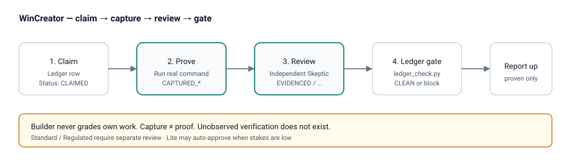
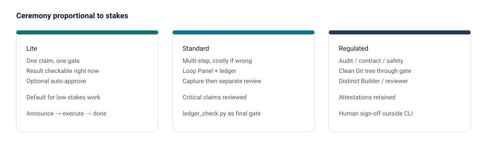
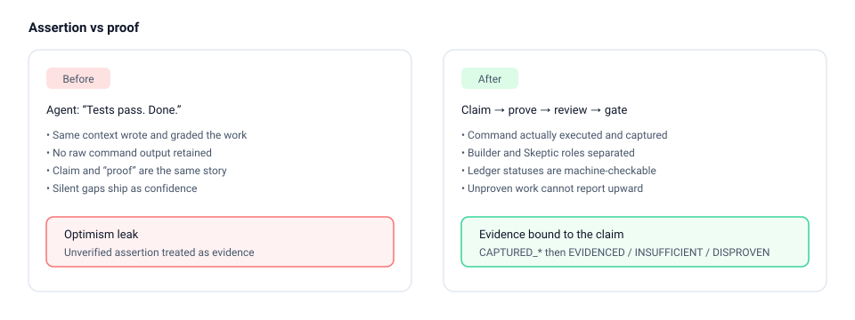

# WinCreator

**Stop your AI agent from turning “the command passed” into “the claim is true.”**

WinCreator is a small proof protocol for agent work. Each claim gets a real gate, the gate's raw output is captured, and a separate review decides whether that evidence actually proves the claim. A **Done Gate** then refuses “done” while unproven claims remain — in the agent session and in CI.

[](https://github.com/winterbim/wincreator/actions/workflows/ci.yml?query=branch%3Amaster)
[](https://github.com/winterbim/wincreator/actions/workflows/proof-ledger.yml?query=branch%3Amaster)
[](LICENSE)
[](https://github.com/winterbim/wincreator/releases/latest)

Français : [README.fr.md](README.fr.md)



## See it in 5 seconds

No install, no LLM, no dependency — Python 3.10+ only:

```bash
git clone https://github.com/winterbim/wincreator.git
python3 wincreator/examples/false-green/run_demo.py
```

<!-- demo:false-green:start -->
```text
CLAIM   a refund never exceeds what was paid

$ python3 check_weak.py
2 checks passed   (exit 0)
        green. This is where an agent says "done".

seed the bug the claim is about:  min(requested, paid)  ->  requested
$ python3 check_weak.py            # against the broken code
2 checks passed   (exit 0)
        still green: the fault SURVIVED.

VERDICT INSUFFICIENT
        the gate passed, but it cannot detect the failure it is cited against.

$ python3 check_strong.py          # one added check, same broken code
AssertionError: refund exceeded the amount paid   (exit 1)
        red: the fault is KILLED.

VERDICT ADEQUATE
        now a green run of this gate is evidence for the claim.
```
<!-- demo:false-green:end -->

That transcript is not illustrative: it is what the shipped tool prints, and CI fails if this README stops matching it ([`tests/test_false_green_demo.py`](tests/test_false_green_demo.py)).

## Install

**Claude Code plugin — skill + Done Gate** (Claude Code 2.1.275 or later):

```text
/plugin install wincreator --marketplace winterbim/wincreator
```

On earlier versions: `/plugin marketplace add winterbim/wincreator`, then `/plugin install wincreator@wincreator`.

**Any agent that reads Agent Skills** (Claude Code, Codex, Cursor and others) — skill only:

```bash
npx skills add winterbim/wincreator
```

Manual copy and the ChatGPT zip are under [Other installation paths](#other-installation-paths).

## The three mechanisms

### 1. Prove — a passing command is not yet a proven claim

```bash
export WC=~/.claude/skills/wincreator   # wherever the skill was installed
python3 "$WC/scripts/quick_prove.py" \
  "parser rejects malformed input" \
  -- python3 check_parser.py
```

One command creates a minimal `.wincreator/PROOF_LEDGER.md`, binds the exact plain-language claim to the exact command, captures stdout, stderr, exit status, timing, environment and Git context, and writes a tamper-evident attestation. WinCreator then keeps two questions apart:

```text
Did the command succeed?        -> CAPTURED_PASS / CAPTURED_FAIL / CAPTURE_ERROR
Does that evidence prove this?  -> EVIDENCED / INSUFFICIENT / DISPROVEN
```

In the default **Lite** tier a passing gate is approved mechanically. Add `--tier standard` and the same green command stops at `PENDING`: the output prints the two exact commands to hand to an independent reviewer, who receives a blind packet (claim, gate, raw evidence — not the Builder's reasoning) and may answer `INSUFFICIENT` or `DISPROVEN`.



### 2. Done Gate — “done” is refused while unproven claims remain

A skill is advice; an agent can read it and still announce “done” over a ledger of `CLAIMED` rows. The Done Gate moves that last rule out of the agent's judgment.

**In the agent session.** The plugin registers a stop hook. When the agent tries to end its turn while a ledger holds `CLAIMED`, `DISPROVEN` or `INSUFFICIENT` rows, it is sent back with the list and four honest exits: prove the claim, record the user's explicit waiver, supersede it, or tell the user plainly what is unproven. It raises a given set of open claims once per session and never loops. `WINCREATOR_DONE_GATE=off` disables it.

**In CI.** The same decision as a GitHub Action, with a claims table in the job summary:

```yaml
# .github/workflows/proof-ledger.yml
name: proof-ledger
on: [push, pull_request]
jobs:
  done-gate:
    runs-on: ubuntu-latest
    steps:
      - uses: actions/checkout@v4
      - uses: winterbim/wincreator@master   # or pin a release tag / commit SHA
```

Name the workflow `proof-ledger` and its native status badge becomes live evidence in your own README, not a sticker:

```markdown
[](https://github.com/OWNER/REPO/actions/workflows/proof-ledger.yml)
```

**Anywhere else** (pre-commit, Makefile, another agent's hook): `python3 "$WC/scripts/done_gate.py"` exits non-zero while unproven claims remain. Details and limits: [`references/done-gate.md`](skill/wincreator/references/done-gate.md).

### 3. Test the tests — can the gate see the failure it is cited against?

This is the mechanism behind the demo above. Declare the fault the claim is about; if the gate stays green with the fault seeded, the verdict is `INSUFFICIENT`, never a soft warning:

```bash
python3 "$WC/scripts/adequacy_check.py" run \
  --root . \
  --manifest .wincreator/adequacy.json \
  --out .wincreator/adequacy-report.json \
  -- python3 -m pytest -q
```

It is deliberately narrower than a mutation-testing framework; when a mature mutator already fits your stack, use it and bind its report as evidence. See [`references/evidence-adequacy.md`](skill/wincreator/references/evidence-adequacy.md).

## Three tiers



| Tier | Use it when | Behavior |
|---|---|---|
| **Lite** | one claim, one gate, directly inspectable | zero-setup proof, automatic mechanical approval |
| **Standard** | multi-step or expensive-to-miss failure | captured gate + separate review |
| **Regulated** | audited / contractual / safety / compliance-relevant work | Standard + clean Git state, distinct builder/reviewer IDs, retained attestations and surrounding human sign-off policy |

If you cannot name why the task needs Standard, use Lite.

`Regulated` is a workflow tier, **not a compliance certification**. HMAC is tamper evidence for a key holder, not a public signature or transparency log.

## What is proven about WinCreator itself — and what is not

- **Proven, mechanically:** the tools do what this page says. Every script ships an adversarial self-test, the external suite runs on Ubuntu, Windows and macOS across Python 3.10–3.13, and this repository's own ledgers pass its own Done Gate on every push.
- **Proven, once, on a real session:** a Skeptic caught a missing error path after green tests — [`worked-example.md`](skill/wincreator/references/worked-example.md).
- **Measured, and not in our favor:** on 11 small false-green tasks, Claude Code with Claude Haiku 5.5 passed 33/33 held-out graders with WinCreator ON and 33/33 with it OFF, with zero false “done” reports in either arm; the ON arm cost 57% more. The benchmark hit its ceiling, so it shows no benefit at this task size. [Result and raw data](bench/results/2026-11-11-claude-code-haiku-5-5/README.md).
- **Not measured:** long sessions, large repositories, weaker models, other agents, and the value of the audit trail to a human reviewer. Treat “it makes agents better” as `CLAIMED` until a benchmark that does not saturate says otherwise.

## The full protocol

The installable skill adds four defenses to longer agent sessions:

- **Optimism leak** → Proof Ledger + Builder/Skeptic separation
- **Context rot** → Loop Panel
- **Stuck loops** → Two-Failure Rule
- **Complexity creep** → measured Distillation Gate

Read [`skill/wincreator/SKILL.md`](skill/wincreator/SKILL.md) for the complete protocol.



## Code distillation

For consequential code changes, WinCreator can preserve a working candidate, measure its structural cost, and compare a behavior-preserving simplification without pretending that code quality is one magic score:

~~~bash
python3 "$WC/scripts/distill_check.py" snapshot \
  --root . --scope src \
  --out .wincreator/distill-before.json

# simplify the already-working implementation

python3 "$WC/scripts/distill_check.py" compare \
  --before .wincreator/distill-before.json \
  --baseline-digest <digest-frozen-before-editing> \
  --root . \
  --out .wincreator/distill-report.json
~~~

Freeze the printed baseline digest in pre-change evidence before simplifying. Any new direct dependency, measured structural regression, or scan warning becomes **REVIEW_REQUIRED**. The final functional proof is still run through WinCreator and can bind both JSON artifacts with `--file`. See [`references/code-distillation.md`](skill/wincreator/references/code-distillation.md).

## Manual capture API

If you already maintain a ledger row, use the lower-level CLI directly:

```bash
python3 "$WC/scripts/wincreator.py" prove P2 \
  --tier standard \
  --builder builder-01 \
  --ledger PROOF_LEDGER.md \
  -- python3 check_parser.py
```

Build the blind packet from the capture, then review:

```bash
python3 "$WC/scripts/challenge_packet.py" create \
  --attestation <attestation.json> \
  --out .wincreator/challenge-packet.json

python3 "$WC/scripts/wincreator.py" review P2 \
  --ledger PROOF_LEDGER.md \
  --verdict evidenced \
  --reviewer skeptic-01 \
  --challenge "attack whether the captured gate is sufficient for the exact claim" \
  --challenge-packet .wincreator/challenge-packet.json
```

Verify capture logs, review linkage and ledger bindings:

```bash
python3 "$WC/scripts/wincreator.py" verify --ledger PROOF_LEDGER.md
```

## Sensitive data

Captured output and metadata can contain secrets. Use the built-in controls before execution:

```bash
python3 "$WC/scripts/quick_prove.py" \
  "private integration check succeeds" \
  --redact "$TOKEN" \
  --redact-regex 'password=[^ ]+' \
  --max-output-bytes 1048576 \
  --no-output-body \
  --private \
  -- python3 check_integration.py
```

Redaction rules are validated before the gate starts, then applied before retained output is hashed. The gate process never inherits `WINCREATOR_SIGNING_KEY`; signing happens only after the gate exits.

## Other installation paths

**Claude Code — manual copy**

```bash
git clone https://github.com/winterbim/wincreator.git
mkdir -p ~/.claude/skills
cp -r wincreator/skill/wincreator ~/.claude/skills/wincreator
python3 ~/.claude/skills/wincreator/scripts/ledger_check.py --self-test
python3 ~/.claude/skills/wincreator/scripts/wincreator.py --self-test
```

**ChatGPT / manual package**

Build or download `skill.zip`, then upload it:

```bash
./tools/build_package.sh
```

Release assets: [latest release](https://github.com/winterbim/wincreator/releases/latest). The default branch can be ahead of the latest release; [CHANGELOG.md](CHANGELOG.md) says what each contains.

Release packages are also published with GitHub/Sigstore build-provenance attestations. After downloading an artifact, verify where it came from with:

```bash
gh attestation verify skill.zip -R winterbim/wincreator
```

That provenance proves which repository/workflow/commit produced the artifact; it does not replace WinCreator's semantic proof ledger or claim review.

## Development gates

```bash
python3 -m compileall -q skill/wincreator/scripts tools tests bench
python3 skill/wincreator/scripts/ledger_check.py --self-test
python3 skill/wincreator/scripts/wincreator.py --self-test
python3 skill/wincreator/scripts/distill_check.py --self-test
python3 skill/wincreator/scripts/adequacy_check.py self-test
python3 skill/wincreator/scripts/challenge_packet.py self-test
python3 skill/wincreator/scripts/done_gate.py --self-test
python3 bench/run_ablation.py --self-test
python3 bench/validate_cases.py
python3 skill/wincreator/scripts/package_check.py --self-test
python3 -m pytest -q
python3 skill/wincreator/scripts/package_check.py skill/wincreator
python3 skill/wincreator/scripts/done_gate.py
python3 skill/wincreator/scripts/ledger_check.py --catches skill/wincreator/SKEPTIC_CATCHES.md
python3 tools/render_demo_svg.py --check
./tools/build_package.sh
```

CI runs across Ubuntu, Windows and macOS on Python 3.10–3.13 and validates the packaged skill with the pinned OpenAI Skill Creator and Agent Skills reference validators.

## Project map

| Resource | Purpose |
|---|---|
| [`examples/false-green/`](examples/false-green/) | the 5-second demo: a green gate judged `INSUFFICIENT` |
| [`skill/wincreator/scripts/quick_prove.py`](skill/wincreator/scripts/quick_prove.py) | zero-setup default path |
| [`skill/wincreator/scripts/done_gate.py`](skill/wincreator/scripts/done_gate.py) | stop hook, CI gate and CLI behind the Done Gate |
| [`skill/wincreator/scripts/adequacy_check.py`](skill/wincreator/scripts/adequacy_check.py) | seeded-fault check that a gate can fail for the right reason |
| [`skill/wincreator/scripts/distill_check.py`](skill/wincreator/scripts/distill_check.py) | structural before/after evidence for code distillation |
| [`examples/minimal/`](examples/minimal/) | runnable sandbox for the manual ledger flow |
| [`skill/wincreator/references/worked-example.md`](skill/wincreator/references/worked-example.md) | real Skeptic catch |
| [`skill/wincreator/SKILL.md`](skill/wincreator/SKILL.md) | full protocol |
| [`bench/`](bench/README.md) | paired ON/OFF ablation harness |
| [`docs/DEMO.md`](docs/DEMO.md) | short demonstration flow |
| [Releases](https://github.com/winterbim/wincreator/releases) | packaged artifacts |

## Contributing and security

See [CONTRIBUTING.md](CONTRIBUTING.md) — every pull request carries a ledger gate and a Skeptic pass. Report vulnerabilities privately as described in [SECURITY.md](SECURITY.md).

## License

MIT — see [LICENSE](LICENSE). Copyright Winter Fernandes.
